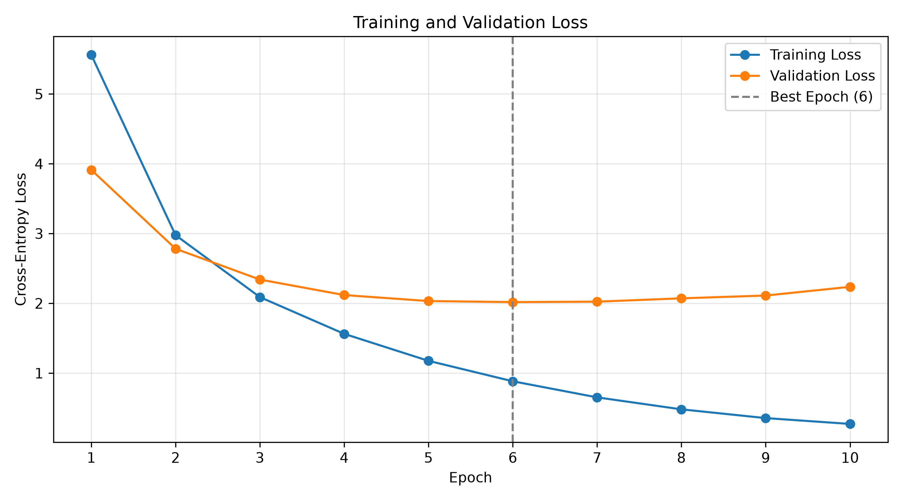
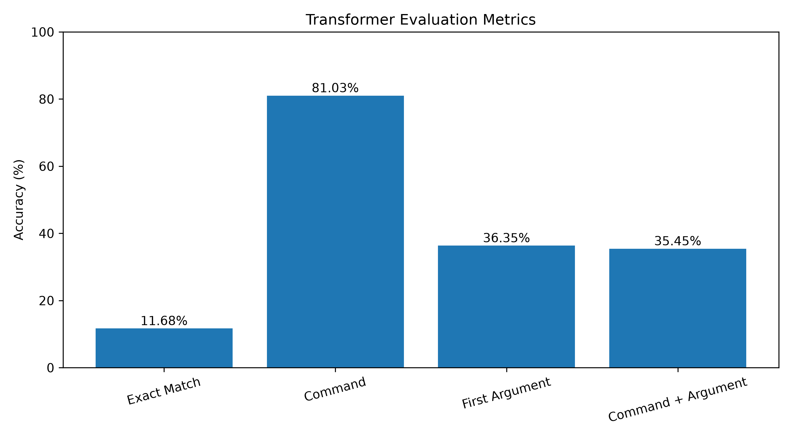
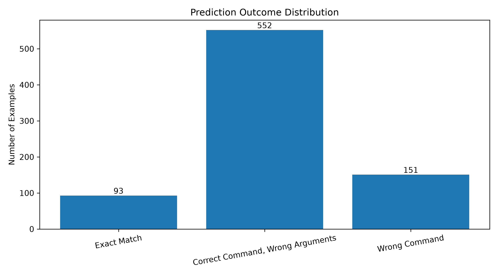
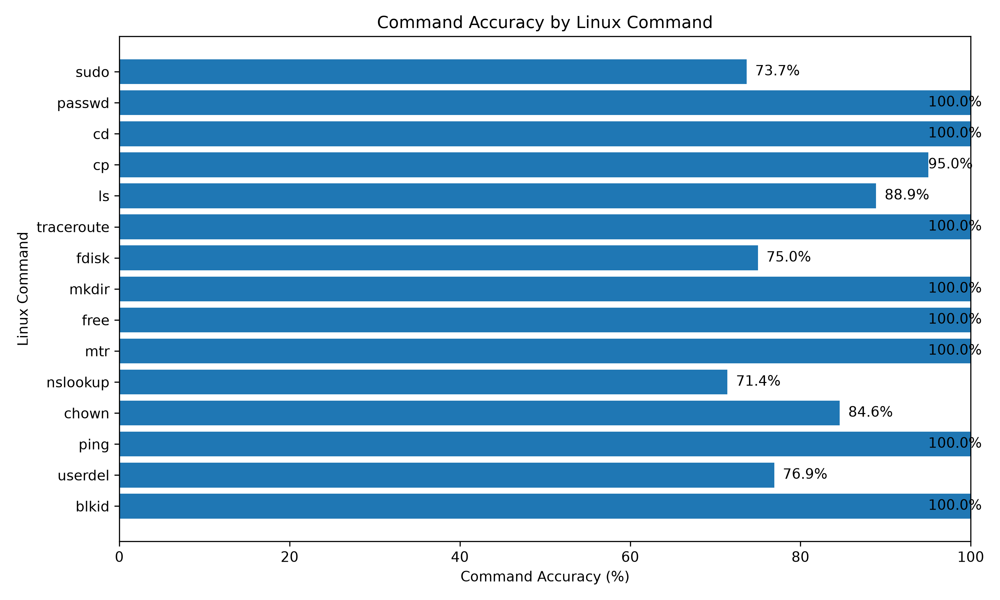

# Transformer From Scratch: Natural Language to Linux Commands

A Transformer Encoder-Decoder implemented from scratch with PyTorch, trained to translate natural language descriptions into Linux commands.

This project started as a way to better understand the original Transformer architecture from *Attention Is All You Need*. Rather than relying on a pretrained model, I wanted to implement the main components myself, train the architecture on a real task, and evaluate how well it could generalize.

For the Transformer implementation, I followed **[Umar Jamil's Transformer from Scratch walkthrough](https://www.youtube.com/watch?v=ISNdQcPhsts)**, which helped me understand and implement the architecture step by step.

## 1. Overview

The goal is simple: given a description of a task in natural language, the model generates a corresponding Linux command.

For example:

**Input**
```text
List all files including hidden files
```

**Expected output**
```bash
ls -la
```

The model uses a sequence-to-sequence architecture:

- The **Encoder** processes the natural language description.
- The **Decoder** generates the Linux command autoregressively, one token at a time.

The model is trained from randomly initialized weights. The GPT-2 tokenizer is used for tokenization, but **no pretrained GPT-2 model weights are used**.

## 2. Architecture

The implementation follows the original Transformer Encoder-Decoder architecture.

The main components were implemented using PyTorch:

- Input Embeddings and Positional Encoding
- Multi-Head Attention
- Masked Self-Attention
- Encoder-Decoder Cross-Attention
- Feed Forward Networks
- Residual Connections and Layer Normalization
- Encoder and Decoder Blocks
- Linear Projection to Vocabulary Logits

The Encoder processes the input description through self-attention layers.

The Decoder uses masked self-attention to prevent access to future tokens and cross-attention to incorporate information from the Encoder.

During inference, the Decoder generates tokens autoregressively until it predicts the end-of-sequence token or reaches the maximum generation length.

### Model Configuration

| Parameter | Value |
|---|---|
| Architecture | Transformer Encoder-Decoder |
| Encoder Layers | 2 |
| Decoder Layers | 2 |
| Model Dimension (`d_model`) | 64 |
| Attention Heads | 4 |
| Feed Forward Dimension | 128 |
| Dropout | 0.0 |
| Source Sequence Length | 64 |
| Target Sequence Length | 96 |
| Tokenizer | GPT-2 + special tokens |

The architecture is intentionally small to keep training manageable on a consumer GPU.

## 3. Dataset

The model was trained on a dataset containing natural language descriptions paired with Linux commands.

The original dataset contained **8,669 examples**.

Before training, I removed duplicate entries and split the dataset into three subsets:

- **Training set:** Used to optimize the model parameters.
- **Validation set:** Used to monitor generalization and select the best checkpoint.
- **Test set:** Used only for the final evaluation.

The data is stored in:

```text
data/
└── processed/
    ├── train.json
    ├── val.json
    └── test.json
```

### Tokenization

I used the GPT-2 tokenizer with two additional special tokens:

- `<|bos|>` — Beginning of sequence
- `<|pad|>` — Padding token

During training, the Decoder receives a sequence starting with BOS, while the target labels end with EOS.

Padding tokens in the target labels are ignored when computing the loss.

## 4. Training

The Transformer was trained from scratch using PyTorch.

Training configuration:

| Parameter | Value |
|---|---|
| Optimizer | AdamW |
| Learning Rate | 0.001 |
| Loss Function | CrossEntropyLoss |
| Gradient Clipping | 1.0 |
| Maximum Epochs | 10 |
| GPU | NVIDIA RTX 4060 Laptop (8 GB) |

The training process includes:

- Teacher forcing during training
- Padding and causal attention masks
- Training and validation loss monitoring
- Gradient clipping
- Checkpoint saving after each epoch

### Training Results



The training loss decreases consistently throughout the 10 epochs.

However, the validation loss reaches its minimum at **epoch 6** before gradually increasing.

This indicates that the model starts overfitting after approximately six epochs.

The checkpoint from epoch 6 was selected for the final evaluation.

**Best validation loss: 2.0178**

## 5. Evaluation

The model was evaluated on **796 test examples** using the checkpoint from epoch 6.

Rather than relying only on Exact Match Accuracy, I used several metrics to better understand what the model learned.

### Evaluation Metrics

| Metric | Accuracy |
|---|---:|
| Exact Match | **11.68%** |
| Command Accuracy | **81.03%** |
| First Argument Accuracy | **36.35%** |
| Command + First Argument Accuracy | **35.45%** |



**Exact Match** measures whether the entire generated command matches the reference command.

**Command Accuracy** checks whether the main Linux command is correct, regardless of its arguments.

**First Argument Accuracy** measures whether the first argument matches the reference, considering only examples with at least one argument.

**Command + First Argument Accuracy** requires both the main command and its first argument to be correct.

The last two metrics are calculated over 773 test examples containing at least one argument.

These metrics use whitespace-based command splitting, so they do not fully account for complex shell syntax.

### Error Analysis



The results show a noticeable difference between identifying the correct Linux utility and generating a complete command.

The model predicts the correct main command in **81.03%** of the test examples.

However, Exact Match Accuracy is only **11.68%**.

This suggests that the model has learned useful relationships between natural language descriptions and Linux utilities, but still struggles to generate complete argument sequences.

Another limitation of Exact Match is that two different Linux commands can sometimes be functionally equivalent.

For example:

```bash
ls -la
```

and

```bash
ls -al
```

can produce equivalent results, but Exact Match treats them as different outputs.

### Performance by Linux Command



This figure compares command identification accuracy across Linux utilities with at least 10 examples in the test set.

It helps identify which commands the model learned more reliably and which remain challenging.

## 6. Run with Docker

The trained model, tokenizer, and configuration are hosted on Hugging Face:

[hamza-allali/linux-command-transformer](https://huggingface.co/hamza-allali/linux-command-transformer)

The Docker image downloads this model during the build process. This keeps the
GitHub repository lightweight: users do not need local training data or
checkpoints to generate commands.

Build the image:

```bash
docker build -t linux-command-transformer .
```

Generate a Linux command:

```bash
docker run --rm linux-transformer "List all files"
```

Example output:

```text
ls -la*
```

## 7. Installation and Usage

Clone the repository:

```bash
git clone <repository-url>
cd transformer-from-scratch
```

Create a virtual environment:

```bash
python -m venv .venv
source .venv/bin/activate
```

Install the dependencies:

```bash
pip install -r requirements.txt
```

### Training

To train the Transformer:

```bash
python -m src.train
```

The training script monitors training and validation losses and saves model checkpoints after each epoch.

### Evaluation

To evaluate the trained model:

```bash
python -m src.evaluate
```

By default, the evaluation script loads the checkpoint from epoch 6.

It computes the four evaluation metrics and saves the predictions to:

```text
results/evaluation_results.csv
```

### Visualizations

To generate the training and evaluation figures:

```bash
python -m src.visualize
```

The figures are saved in:

```text
results/figures/
```

## 8. Limitations and Future Improvements

The main limitation of this project is the relatively small dataset, containing around 8,000 examples. This limits the model's ability to learn the diversity and complexity of Linux commands, especially when generating arguments, file paths, and longer sequences.

Another limitation is the available hardware. Training was performed on an NVIDIA RTX 4060 Laptop GPU with 8 GB of VRAM, which constrained the experiments I could run with larger models and datasets.

Despite these limitations, the model achieved 81.03% Command Accuracy, although generating complete commands remains challenging.

Possible improvements include:

- Training on a larger and more diverse dataset.
- Experimenting with larger Transformer architectures.
- Applying regularization techniques to improve generalization.

## 9. Acknowledgments

The Transformer architecture in this project was implemented with guidance from **Umar Jamil's [Coding a Transformer from Scratch on PyTorch](https://www.youtube.com/watch?v=ISNdQcPhsts)** walkthrough.

His explanation was particularly useful for understanding the internal components of the Encoder-Decoder architecture and how they interact.

The Linux command generation task, dataset preparation, training experiments, evaluation metrics, and results analysis were developed as part of my own learning project.

The architecture is based on the original paper:

**Vaswani et al. (2017) — [Attention Is All You Need](https://arxiv.org/abs/1706.03762)**.
